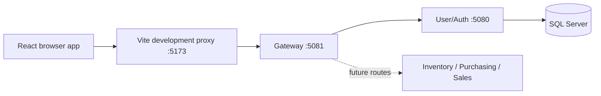

# Medzo API Gateway

ASP.NET Core 10 + YARP gateway for the existing User/Auth API. Backend services retain authentication, authorization, business logic, and database access. The gateway has no database or JWT signing secret.



## Run locally

Install the .NET 10 SDK and the frontend's Node.js dependencies. Start the existing backend with its SQL Server and JWT configuration (see its README), then use separate terminals:

```powershell
# From D:\csp project
dotnet run --project medzo-user-auth-service/src/Medzo.Auth.Api
dotnet run --project medzo-infrastructure/api-gateway/src/Medzo.Gateway

# In the frontend folder
npm ci
npm run dev
```

Open http://localhost:5173. Its `/api` requests now go through port 5081 to the backend on port 5080. Remove any local `VITE_API_BASE_URL` override pointing directly to the backend if you want to test the proxy. `GET http://localhost:5081/health` reports gateway liveness only.

The routes `/api/auth/{**remainder}`, `/api/users/{**remainder}`, `/api/dashboard/{**remainder}`, `/api/reviews`, and `/api/contact` preserve their paths. Unknown routes return 404. Backend connection failures return 502. Requests time out after 30 seconds of inactivity. Future service folders currently have no implementation, so they have no active routes.

## Verification

```powershell
dotnet test medzo-infrastructure/api-gateway/Medzo.Gateway.slnx -c Release
```

Integration tests start a real HTTP stub backend and exercise YARP through a test host. They check path/query/body/credential forwarding, cookie creation/deletion responses, 401 propagation, route isolation, credentialed CORS, and backend outage behavior. They do not replace a browser login test against the real auth service and database.

## Docker

Run from this gateway folder:

```powershell
docker build -f docker/Dockerfile -t medzo-api-gateway .
docker run --rm -p 5081:8080 -e ReverseProxy__Clusters__auth__Destinations__primary__Address=http://host.docker.internal:5080/ medzo-api-gateway
```

The container listens on 8080 and runs as the .NET image's non-root user. `host.docker.internal` is for Docker Desktop; deployed containers must use the actual backend address.

## Production configuration and cutover

1. Create an Azure App Service for the gateway container. Configure its target port as 8080 (for classic custom-container App Service, `WEBSITES_PORT=8080`; for sidecar-enabled App Service use the container target-port setting).
2. Set `ReverseProxy__Clusters__auth__Destinations__primary__Address` to the **HTTPS** backend root URL, including the trailing slash and excluding `/api`. The local default is not suitable for Azure.
3. If the browser calls the gateway on a different origin, set `Cors__AllowedOrigins__0` to the exact frontend origin, without a trailing slash. Add indexed entries for other permitted origins. Do not use wildcard credentialed CORS. The backend's existing CORS middleware can remain, but browser-facing CORS is owned by the gateway.
4. Keep frontend and API under the same site, for example `app.your-domain.com` and `api.your-domain.com`, both HTTPS, or route `/api` under the frontend origin. The existing auth service uses `SameSite=Strict` refresh cookies. Unrelated Azure hostnames are not a reliable session topology; CORS cannot override SameSite or browser third-party-cookie restrictions. Do not switch production until login, refresh, and logout succeed in a browser. Confirm refresh cookies have `Secure` under the actual Azure HTTPS termination configuration. Configure trusted forwarded headers on the auth host if needed; do not trust arbitrary forwarded headers globally.
5. Verify `/health`, login, session refresh, protected dashboards, reviews/contact, and logout through the gateway. Health alone does not check the database or the deployed image version.
6. In the **frontend GitHub repository**, set the Actions repository variable `VITE_API_BASE_URL` to `https://<your-gateway-host>/api` and rebuild/redeploy the frontend. Its workflow now passes that variable into the Vite build. Until it is set, the existing `.env.production` direct-backend URL remains the deployment fallback. For a same-origin `/api` deployment, set the variable to `/api` and configure the hosting proxy separately.
7. After successful cutover, restrict direct backend access using Azure networking/access restrictions that allow the gateway. CORS is not an access-control boundary. Verify the gateway can still reach the API after restrictions are applied.

Rollback: restore the frontend variable to the previous backend URL and rebuild, or redeploy a previously verified gateway image tagged by commit SHA. Restore backend connectivity rules if reverting to direct calls.

## GitHub Actions deployment

This gateway belongs to **MEDZO-pharmacy/medzo-infrastructure**, under `api-gateway/`. It is not a separate repository. The workflow is stored at the infrastructure repository root in `.github/workflows/gateway-deploy-azure.yml`, and its shell steps run inside `api-gateway/`. The `medzo-api-gateway` Docker image name is an image label, not a repository requirement.

The infrastructure workflow builds, tests, and builds the container on PRs targeting `main` or `Dev` and pushes to those branches when gateway or workflow files change. It can also run manually. Deployment is disabled until repository variable `DEPLOY_ENABLED` is `true`; merges/pushes to `Dev` can then deploy after tests succeed. Configure:

| Type | Name | Value |
| --- | --- | --- |
| Repository variable | `AZURE_REGISTRY_NAME` | Registry resource name |
| Repository variable | `AZURE_WEBAPP_NAME` | Gateway App Service name |
| Repository variable | `GATEWAY_URL` | HTTPS gateway origin, no `/api` |
| Repository variable | `DEPLOY_ENABLED` | `true` after provisioning |
| Secret | `AZURE_CLIENT_ID` | Deployment identity client ID |
| Secret | `AZURE_TENANT_ID` | Azure tenant ID |
| Secret | `AZURE_SUBSCRIPTION_ID` | Subscription ID |

Create a GitHub `production` environment. Set the variables and secrets below on the infrastructure repository. Configure Azure OIDC federation for subject `repo:MEDZO-pharmacy/medzo-infrastructure:environment:production` because the deployment job uses that environment. Give the deployment identity permission to push images (for a standard RBAC registry, AcrPush) and update the gateway App Service. The App Service identity also needs image-pull permission (typically AcrPull); configure its registry authentication. ABAC-enabled registries use their corresponding repository roles.

No cloud resources, custom domains, identities, access restrictions, or GitHub secrets are created by these files. No database migration is needed for the gateway. Rate limiting and gateway-level JWT validation are future work; backend authorization remains mandatory.

## Adding services later

Add one cluster per implemented backend, using deployment configuration for its address, and explicit routes for its agreed API prefixes. Avoid a catch-all route to the auth service. Add forwarding tests for the new prefixes and preserve authorization inside each destination service.
